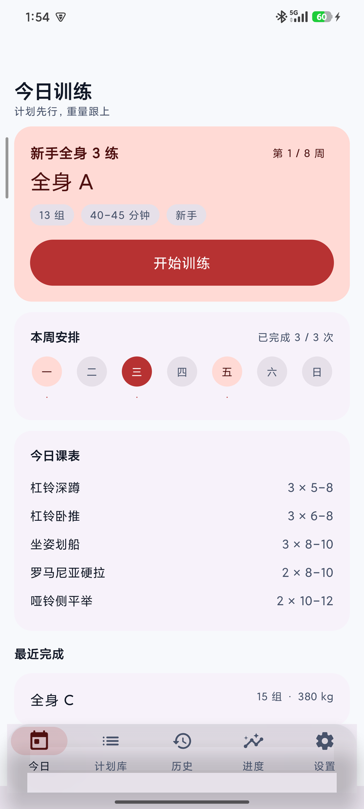
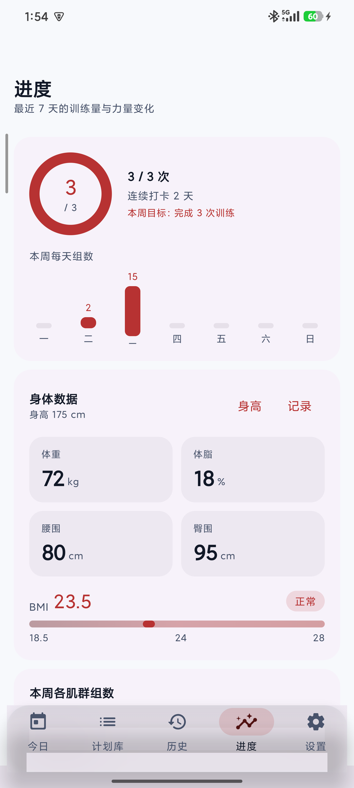
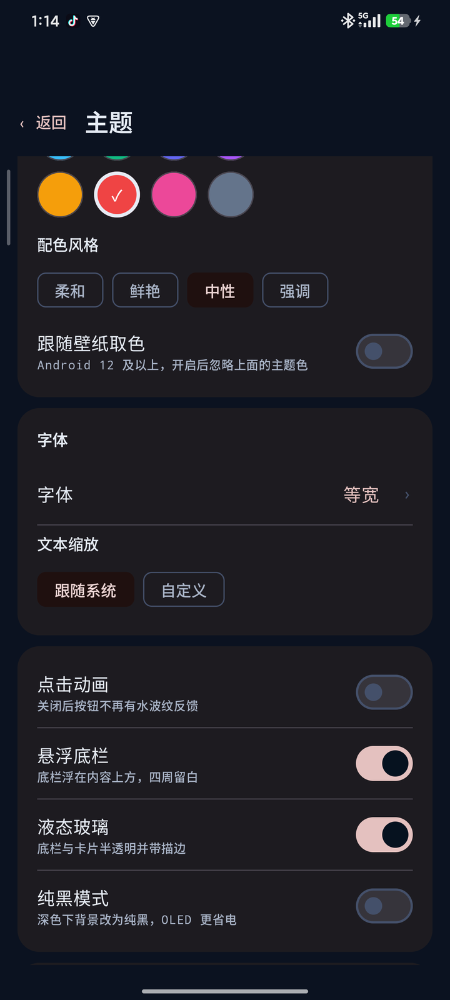
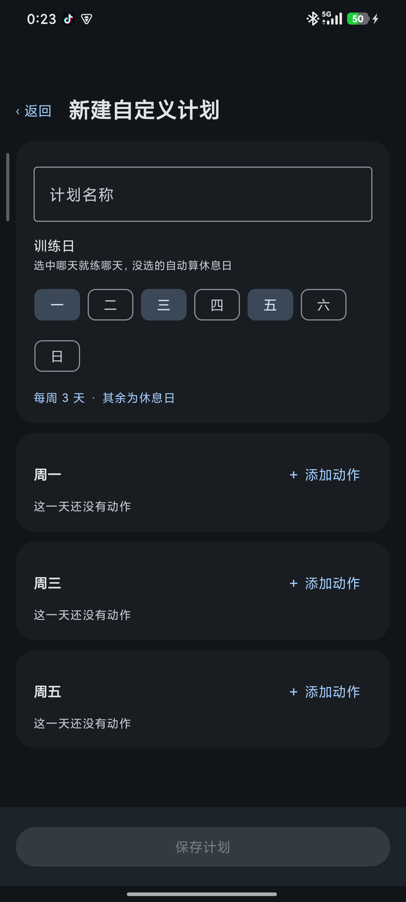
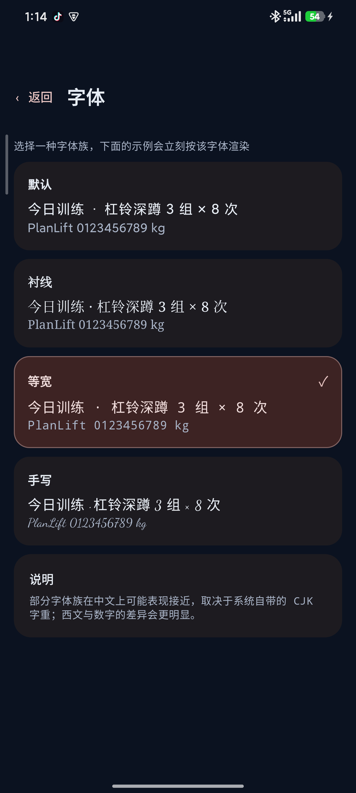
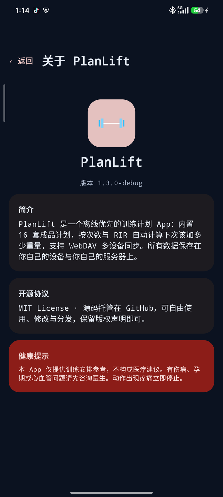

# PlanLift

> 计划先行，重量跟上 · Plan first. Load follows.

一个**离线优先**的 Android 训练计划 App：内置 16 套成品计划（男 8 / 女 8），按次数与 RIR 自动计算下次该加多少重量，支持 WebDAV 多设备同步、中英双语与深度主题定制。

<p align="center">
  
  
  
</p>

## 功能

| 模块 | 说明 |
|---|---|
| 计划库 | 16 套内置计划 + 自定义计划，按性别/天数/目标筛选；自定义计划支持右滑删除 |
| 自动加重 | 全部组达到次数上限且仍有余力 → 自动加一档（下肢 5 kg / 上肢 2.5 kg，女性减半）；低于下限则降半档 |
| 训练记录 | 逐组输入重量/次数/RIR，组间自动计时，完成后重量自动带给下一组 |
| 自定义计划 | 按星期几安排训练日，未选中的自动算休息日 |
| 进度 | 本周完成环、连续打卡、每天组数、每肌群周组数、e1RM、身体数据与 BMI |
| 主题 | 8 个主题色 + 动态取色、4 种配色风格、4 种字体、文本缩放、悬浮/固定底栏、液态玻璃、纯黑模式 |
| 同步 | 自填 WebDAV 地址与账号，快照 + 版本号合并，重复/冲突不会互相覆盖 |
| 提醒 | 每天可自定义时间的训练提醒 |
| 数据 | JSON / CSV 导出，可分享到任意目标 |

## 截图

| 今日 + 悬浮玻璃底栏 | 进度与 BMI | 主题 |
|---|---|---|
|  |  |  |

| 自定义计划（按周安排） | 字体 | 关于 |
|---|---|---|
|  |  |  |

## 技术栈

- Kotlin 2.0 · Jetpack Compose (Material 3)
- Room 2.6（含 v1→v2 迁移）· kotlinx.serialization
- WorkManager（训练提醒）· OkHttp（WebDAV）
- Haze（真正的背景模糊，Android 12+）
- minSdk 26 / targetSdk 34 · arm64-v8a

## 构建

需要 **JDK 17**、Android SDK（platform 34、build-tools 34.0.0）。

```bash
export JAVA_HOME=/path/to/jdk-17
./gradlew assembleDebug          # 产物：app/build/outputs/apk/debug/app-debug.apk
./gradlew testDebugUnitTest      # 20 项单元测试（加重引擎 12 + 同步合并 8）
```

> 项目路径**不能包含中文**：AGP 会直接拒绝非 ASCII 路径。
> Maven 依赖通过阿里云镜像解析（见 `settings.gradle.kts`），国内网络无需额外配置。

## 项目结构

```
app/src/main/
├── assets/              plans.json（16 套计划）· exercises.json（38 个动作）
├── java/app/planlift/fit/
│   ├── data/local/      Room 实体、DAO、数据库迁移
│   ├── data/content/    内容层（计划/动作，双语）
│   ├── data/repo/       业务仓储（加重建议、统计、自定义计划）
│   ├── data/sync/       WebDAV 客户端、快照、合并
│   ├── domain/          加重引擎、同步合并算法（纯函数，可单测）
│   └── ui/              今日/计划/训练/历史/进度/设置
└── res/                 中英双语资源
```

## 数据与内容来源

16 套计划的组数、次数区间与 RIR 来自公开且已核对的训练文献与计划库（SmartWorkout 计划库、Muscle & Strength、Barbell Medicine、NSCA/JSCR 相关研究等），并与《男女健身计划总表》一一对应。每套计划在 App 内标注来源，不含任何 AI 编造的训练参数。

## 免责声明

本 App 仅提供训练安排参考，不构成医疗建议。有伤病、孕期或心血管问题请先咨询医生；动作出现疼痛立即停止。

## License

[MIT](LICENSE)
